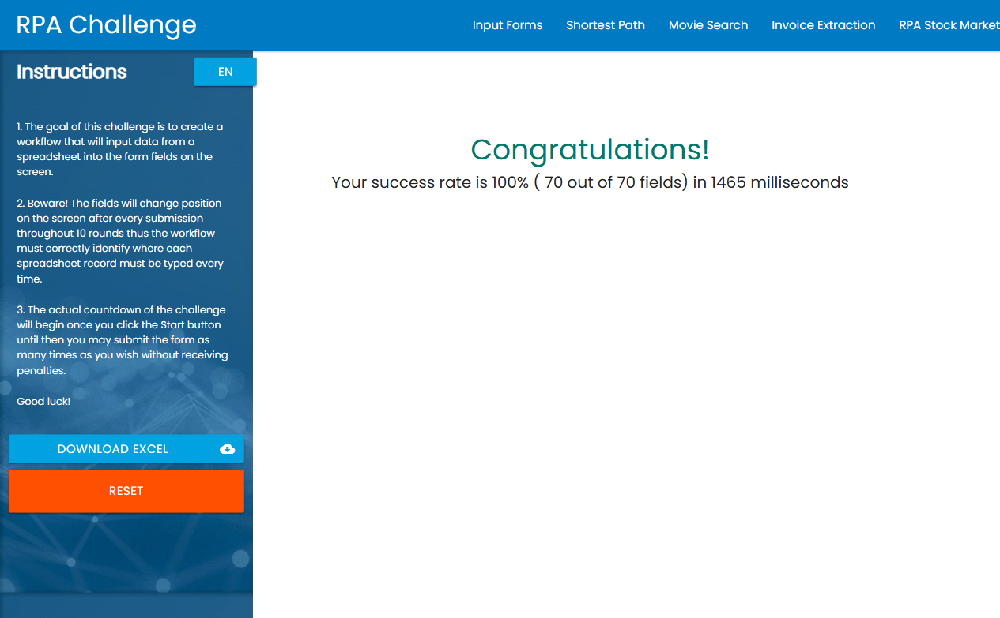

# RPA Challenge Bot — Playwright + Node.js


An RPA bot that solves the [RPA Challenge](https://rpachallenge.com/): it downloads an Excel file, validates the data, and fills a web form **10 times**, while the form fields **change position every round**.

**Result:** 100% success rate (70 of 70 fields) in **1465 ms**.



---

## The business problem

Many companies still copy data from spreadsheets into web systems by hand. It is slow, boring and error-prone. This project shows how that work can be automated in a reliable way — the same approach applies to CRMs, ERPs, government portals and internal systems.

## Key features

| Feature | Why it matters for a real client |
|---|---|
| **Dynamic layout handling** | Fields are found by their label, not by position, so the bot keeps working when the screen layout changes. |
| **Data validation before execution** | Empty fields, invalid emails and missing columns are detected *before* the bot touches the system, with the Excel row number. |
| **Value verification** | After filling each field, the bot reads it back to confirm the value was really written. |
| **Automatic retries** | Unstable steps (page load, download, rendering) are retried before failing. |
| **Logs and evidence** | Every run creates a log file, a JSON report and a screenshot (`result.png` or `error.png`). |
| **Automated tests + CI** | Unit tests and an offline end-to-end test run on every push with GitHub Actions. |
| **Docker support** | Runs the same way on any machine or server. |

## Tech stack

Node.js · Playwright · ExcelJS · Node test runner · GitHub Actions · Docker

## Project structure

```
src/
  index.js            # Main flow (orchestration)
  challenge-page.js   # Page Object: all selectors and page actions
  excel.js            # Excel reading, data cleaning and validation
  fields.js           # Field mapping (form label <-> Excel column)
  retry.js            # Generic retry helper
  result-parser.js    # Parses the final score message
  logger.js           # Console + file logging
  config.js           # Configuration via environment variables
test/
  excel.test.js       # Unit tests for data handling
  result-parser.test.js
  e2e-mock.test.js    # Full bot run against an offline copy of the challenge
  mock-site/          # Local mock of rpachallenge.com used in tests
```

## How to run

Requirements: Node.js 20+

```bash
npm run setup        # install dependencies and the Chromium browser
npm start            # run headless
npm run start:headed # run with the browser visible
npm test             # run all tests
```

With Docker:

```bash
docker build -t rpa-challenge .
docker run --rm -v "$(pwd)/output:/app/output" rpa-challenge
```

### Configuration (environment variables)

| Variable | Default | Description |
|---|---|---|
| `HEADLESS` | `true` | Set `false` to see the browser |
| `SLOW_MO` | `0` | Delay (ms) between actions, useful for demos |
| `EXCEL_PATH` | — | Use a local Excel file instead of downloading it |
| `MAX_RETRIES` | `2` | Retries for unstable steps |
| `TIMEOUT_MS` | `15000` | Timeout for each action |
| `OUTPUT_DIR` | `./output` | Where logs, report and screenshots are saved |

## Output

```
output/
  challenge.xlsx   # downloaded input file
  run.log          # step-by-step log
  report.json      # final result
  result.png       # screenshot of the final score
```

Example `report.json`:

```json
{
  "status": "success",
  "recordsProcessed": 10,
  "message": "Your success rate is 100% ( 70 out of 70 fields) in 1465 milliseconds",
  "successRate": 100,
  "correctFields": 70,
  "totalFields": 70,
  "timeMs": 1465,
  "totalRunTimeMs": 8270,
  "finishedAt": "2026-10-01T01:52:59.833Z"
}
```

## How this applies to real projects

The same structure can be adapted to automate tasks such as:

- Entering orders, customers or invoices from Excel into a web system
- Updating records in portals that have no API
- Extracting data from web systems into spreadsheets
- Nightly scheduled processes with logs and error alerts

---

**Need something similar automated?** Contact me on [Upwork](https://www.upwork.com/freelancers/~010e7f216b95541111).
